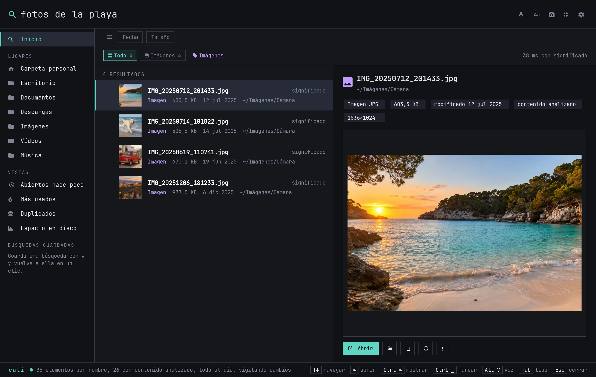
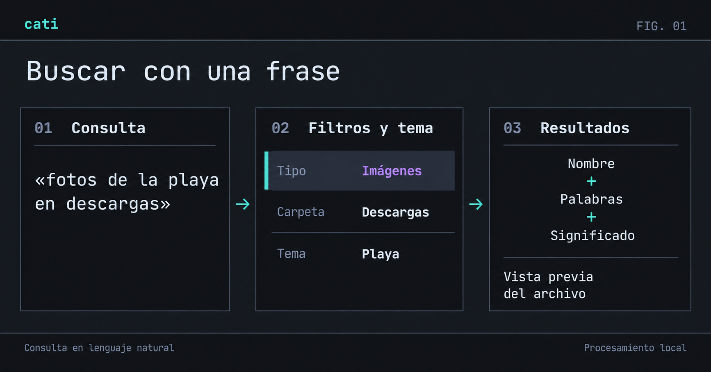
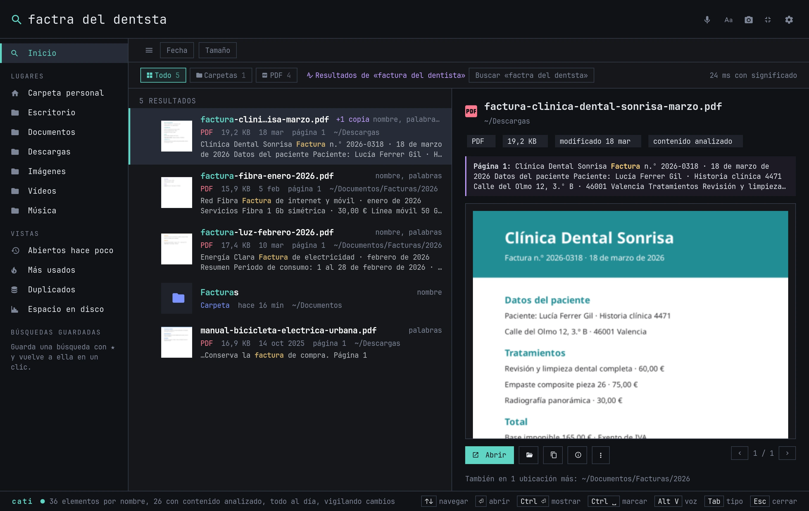
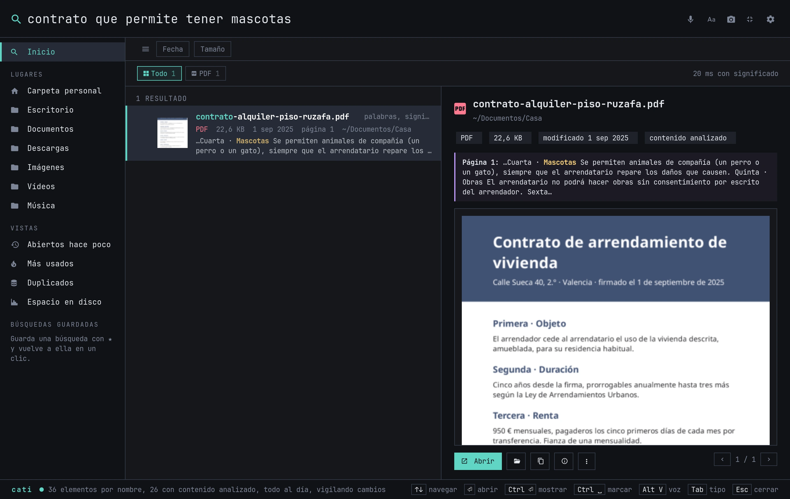
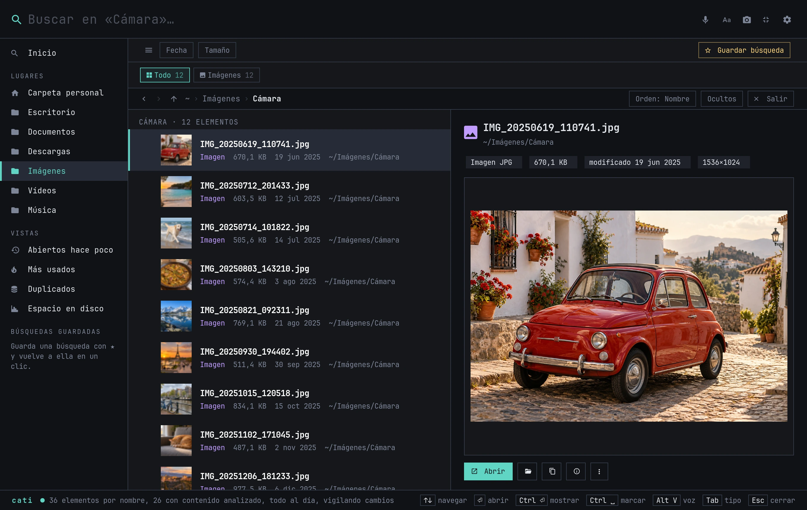
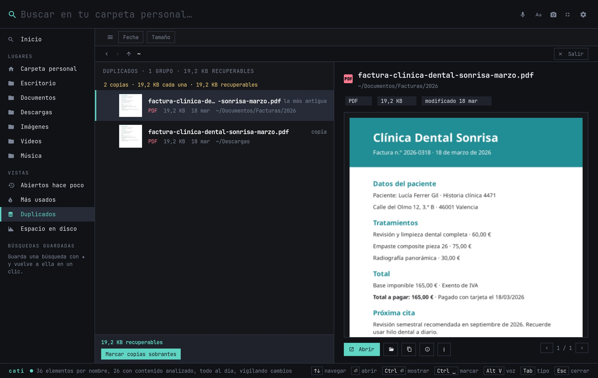
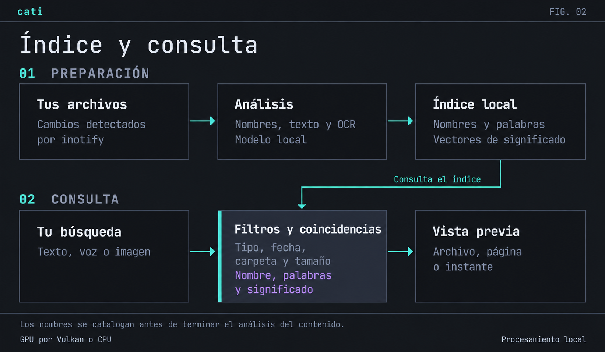

<p align="center">
  
</p>

<h1 align="center">Cati</h1>

<p align="center">
  <b>Busca tus archivos con tus palabras.</b><br>
  En Linux, con vista previa y análisis local.
</p>

<p align="center">
  <sub>Wayland y X11 &nbsp;·&nbsp; Python 3.11+ &nbsp;·&nbsp; <a href="LICENSE">MIT</a></sub>
</p>

<p align="center">
  <a href="#instalación">Instalación</a> ·
  <a href="#uso">Uso</a> ·
  <a href="#en-imágenes">Capturas</a> ·
  <a href="#cómo-funciona">Arquitectura</a>
</p>

<p align="center">
  <a href="docs/buscar-fotos.webp"></a>
</p>

<p align="center"><sub>Captura con archivos de demostración.</sub></p>

Escribe **«fotos de la playa»** o **«contrato que permite tener mascotas»** para buscar por contenido, aunque no recuerdes el nombre. En la captura, Cati encuentra `IMG_20250712_201433.jpg` por lo que muestra la foto.

Puedes revisar los resultados en la vista previa, recorrer carpetas y mover o renombrar archivos. La barra lateral reúne las búsquedas guardadas, los archivos recientes y los más usados.

## Instalación

Necesitas **Linux, Python 3.11 o superior y GTK 4.12 o superior**. Cati usa una GPU compatible con Vulkan o la CPU.

```bash
git clone https://github.com/charlieRub/cati.git
cd cati
./install.sh --deps
```

`--deps` usa `sudo` para instalar los paquetes del sistema que falten. Si ya los tienes, ejecuta `./install.sh`. Cati se instala para tu usuario.

El instalador crea el entorno de Python, descarga y verifica los modelos, compila los motores y configura el arranque en segundo plano. El modelo de búsqueda ocupa **unos 865 MB**. La voz, el OCR y los diccionarios requieren otras descargas. Conserva la carpeta del proyecto: el lanzador usa su entorno y sus binarios.

| Familia que reconoce el instalador | Gestor de paquetes |
| --- | --- |
| Arch y derivadas: CachyOS, EndeavourOS, Manjaro | `pacman` |
| Debian, Ubuntu, Mint | `apt` |
| Fedora | `dnf` |
| openSUSE | `zypper` |

Las pruebas de escritorio se hacen en Arch/Omarchy. En otras distribuciones, comprueba los requisitos con `cati doctor`. Cati funciona en Wayland y X11, con servicios de usuario de systemd o autoarranque XDG.

<details>
<summary><b>Opciones de instalación</b></summary>

| Opción | Efecto |
| --- | --- |
| `--gpu auto` | Detecta Vulkan y usa CPU si no está disponible; es el valor por defecto |
| `--gpu vulkan` / `--gpu cpu` | Usa Vulkan o CPU |
| `--no-voice` | Omite la instalación de la búsqueda por voz |
| `--no-shortcut` | Omite la configuración de atajos |
| `--shortcut "SUPER ALT, E"` | Personaliza el atajo del explorador en Hyprland |
| `--shortcut "<Super><Alt>e"` | Personaliza el atajo del explorador en GNOME |

Consulta las opciones con `./install.sh --help`.

</details>

### Primer arranque

Abre **Cati** desde el lanzador de aplicaciones o ejecuta `cati`. Primero podrás buscar por nombre. Cati analiza el contenido en segundo plano; consulta el progreso en la barra inferior o con `cati status`.

Cada archivo entra en las búsquedas por contenido cuando termina su análisis. Si el modelo estaba inactivo, la primera búsqueda por significado necesita cargarlo en memoria.

Si tu terminal no encuentra `cati`, ejecuta `~/.local/bin/cati` o `./scripts/cati` desde el proyecto. Usa `cati doctor` para comprobar las dependencias y la vigilancia de archivos.

### Integración con el escritorio

| Acceso | Acción | Comando |
| --- | --- | --- |
| Super + Alt + E | Explorador | `cati explorer` |
| Super + Alt + B | Búsqueda rápida | `cati quick` |
| Super + Alt + V | Búsqueda por voz | `cati voice` |

El instalador configura los atajos en **Hyprland y GNOME** si están disponibles. En KDE propone el del explorador en la entrada de la aplicación; en otros escritorios, asigna los comandos de la tabla. Con **F11** cambias entre explorador y búsqueda rápida.

En **Omarchy**, Cati usa los colores del tema activo y aparece en Walker. En Hyprland, el instalador crea `~/.config/hypr/cati.conf` y lo incluye desde `hyprland.conf`. Guarda una copia de seguridad y revierte el cambio si detecta errores al recargar.

## Uso

Escribe en la caja de búsqueda: los resultados se actualizan sin pulsar Enter. Selecciona uno para verlo a la derecha y pulsa **Enter** para abrirlo. Si estás dentro de una carpeta, la búsqueda se limita a ella.

<p align="center">
  <a href="docs/busqueda-natural.png"></a>
</p>

<p align="center"><sub>Figura 1 · Consulta, filtros y resultados. <a href="docs/busqueda-natural.png">Ampliar</a></sub></p>

### Consultas de ejemplo

| Escribes | Qué busca |
| --- | --- |
| `documento html de pirámides` | Archivos `.html` o `.htm` sobre pirámides |
| `foto de una pirámide` | Imágenes que muestran una pirámide, aunque su nombre no la mencione |
| `pdfs en descargas de la semana pasada` | PDF de Descargas modificados la semana anterior |
| `carpeta de egipto` | Carpetas llamadas «Egipto» o con archivos sobre ese tema |
| `vídeos de más de 1 GB` | Vídeos que superan ese tamaño |
| `facturas de 2024` | Da prioridad a 2024 y tiene en cuenta los nombres que incluyen ese año |
| `contrato que permite tener perro` | Pasajes sobre permisos para tener mascotas |
| `factra del dentsta` | Coincidencias aproximadas para «factura del dentista» |
| `code: retry_request` | Código fuente, si activas su análisis en los ajustes |

Las fechas se refieren a la modificación del archivo por defecto. Si pides archivos «que creé» o «descargados», Cati usa la fecha de creación cuando está disponible.

Puedes **arrastrar un resultado** a otra aplicación o **soltar una foto** sobre Cati para buscar imágenes parecidas. Los botones de fecha y tamaño filtran los resultados. Guarda la consulta con **Ctrl + S** o ★ para repetirla desde la barra lateral.

### Voz

Pulsa el micrófono, **Alt + V** dentro de Cati o el atajo global de voz y di lo que buscas. Cati detiene la grabación al detectar silencio y transcribe en tu equipo. Puedes dar órdenes como «abre el segundo», «muéstralo en su carpeta», «propiedades», «siguiente» o «cierra».

<details>
<summary><b>Atajos de teclado</b></summary>

| Tecla | Acción |
| --- | --- |
| ↑ / ↓ · RePág / AvPág | Moverse por los resultados |
| Enter | Abrir el resultado; entrar si es una carpeta |
| Ctrl + Enter | Mostrar en el gestor de archivos |
| Alt + ← / → | Atrás o adelante; si hay un PDF con paginación, cambiar de página |
| Alt + ↑ · Retroceso con la caja vacía | Subir a la carpeta superior |
| Ctrl + L | Enfocar y seleccionar la consulta |
| Ctrl + B | Mostrar u ocultar la barra lateral |
| Ctrl + S | Guardar la búsqueda y sus filtros |
| Ctrl + Espacio · Insertar | Marcar o desmarcar el resultado y avanzar |
| Ctrl + A con la caja vacía | Marcar todos los resultados |
| Ctrl + C | Copiar el archivo y su ruta; si hay selección, copiar los marcados |
| Tab / Mayús + Tab | Cambiar de categoría |
| Alt + Enter · clic derecho | Propiedades y metadatos |
| Alt + V | Buscar por voz |
| F2 | Renombrar |
| Ctrl + M / Ctrl + Mayús + M | Mover / copiar a otra carpeta |
| Ctrl + E / Ctrl + Supr | Comprimir en ZIP / enviar a la papelera |
| Ctrl + Z con la caja vacía | Deshacer la última acción de archivo |
| F11 | Alternar entre explorador y búsqueda rápida |
| Esc | Quitar las marcas, después la imagen de consulta si la hay, o cerrar la ventana |

Al cerrar la ventana, Cati permanece residente y la vigilancia continúa.

</details>

<details>
<summary><b>Línea de órdenes</b></summary>

```bash
cati                                 # abre el explorador
cati quick                           # abre la búsqueda rápida
cati search "fotos de ayer"           # devuelve resultados en JSON
cati search "factura" --lexical       # busca por nombre y palabras, sin embeddings
cati search --image foto.jpg          # busca por similitud visual
cati status                          # muestra el estado del índice
cati doctor                          # comprueba dependencias y vigilancia
cati voice                           # abre Cati escuchando
cati voice --file nota.wav            # transcribe e interpreta un audio
cati folders ~/Documentos ~/Imágenes  # limita el análisis a esas carpetas
cati all                             # vuelve a la carpeta personal y discos montados
```

</details>

## En imágenes

Las capturas usan documentos y fotos de ejemplo. Pulsa una imagen para verla a tamaño completo.

<table>
  <tr>
    <td width="50%" valign="top">
      <a href="docs/erratas.webp"></a>
      <p><b>Erratas</b><br><sub>«factra del dentsta» encuentra la factura y agrupa sus copias.</sub></p>
    </td>
    <td width="50%" valign="top">
      <a href="docs/significado-pdf.webp"></a>
      <p><b>Dentro del PDF</b><br><sub>La búsqueda lleva a la cláusula del contrato sobre mascotas.</sub></p>
    </td>
  </tr>
  <tr>
    <td valign="top">
      <a href="docs/explorador.webp"></a>
      <p><b>Explorador</b><br><sub>Navegación por carpetas y orden por nombre, fecha, tamaño o tipo.</sub></p>
    </td>
    <td valign="top">
      <a href="docs/duplicados.webp"></a>
      <p><b>Duplicados</b><br><sub>Copias de la misma factura y espacio que puedes liberar.</sub></p>
    </td>
  </tr>
</table>

### Gestión de archivos

Selecciona varios archivos con **Ctrl + clic** o **Mayús + clic** para moverlos, copiarlos, comprimirlos o enviarlos a la papelera. Para renombrarlos en lote, puedes buscar y reemplazar texto, numerarlos, cambiar las mayúsculas o añadir prefijos y sufijos. Revisa los nombres antes de aplicar el cambio. Cati evita sobrescribir archivos existentes y permite deshacer las operaciones con **Ctrl + Z**.

En **Duplicados**, Cati compara el contenido de los archivos y excluye los enlaces duros del espacio recuperable. Puedes marcar las copias sobrantes y conservar la más antigua. Antes de enviarlas a la papelera, Cati comprueba que siguen siendo idénticas. En **Espacio en disco**, entra en las carpetas para ver cuánto ocupa cada una.

Abre **Propiedades** para consultar permisos, propietario y fechas, incluida la de creación si el sistema de archivos la guarda. En fotos verás datos de cámara y GPS; en PDF, páginas y autor; en audio y vídeo, los códecs. Instala ExifTool para ver más metadatos. Pulsa un valor para copiarlo.

## Cómo funciona

<p align="center">
  <a href="docs/arquitectura-local.png"></a>
</p>

<p align="center"><sub>Figura 2 · Preparación del índice y búsqueda. <a href="docs/arquitectura-local.png">Ampliar</a></sub></p>

**Índice.** Cati guarda los nombres de archivos y carpetas, incluidos los formatos cuyo contenido no puede leer. Actualiza el catálogo con avisos de inotify y lo revisa cada 30 minutos por defecto para detectar cambios que haya pasado por alto. Analiza el contenido por lotes que puede reanudar tras una interrupción.

**Consulta.** Cati separa los filtros del tema y busca por nombre, palabras y significado. Agrupa las copias y tiene en cuenta los archivos que sueles abrir al ordenar los resultados. Las coincidencias por nombre y texto pueden aparecer mientras el modelo calcula la similitud.

| Componente | Función |
| --- | --- |
| SQLite FTS5 | Catálogo de nombres y búsqueda en el texto extraído |
| Lectores y OCR | Texto, PDF, documentos de Office, imágenes y escaneos |
| FFmpeg | Fotogramas y fragmentos de audio y vídeo |
| EmbeddingGemma 2 sobre llama.cpp | Vectores de texto, imagen y audio para buscar por significado |
| whisper.cpp | Transcripción local de las consultas por voz |

<details>
<summary><b>Formatos y detalles técnicos</b></summary>

Cati extrae texto de archivos de texto, Markdown, HTML, PDF, DOCX, XLSX, PPTX, ODT, ODS, ODP, EPUB y RTF. Para DOC necesita `antiword` o `catdoc`. Puedes buscar los formatos que no puede leer por nombre, tipo y metadatos.

El OCR utiliza PP-OCRv6 mediante RapidOCR y ONNX Runtime, con Tesseract como respaldo. Lee texto en fotos y capturas; en los PDF analiza las páginas y sus imágenes. También extrae imágenes incrustadas en documentos compatibles. Para las vistas previas HTML necesita Chromium; GStreamer permite reproducir audio y vídeo dentro de la ventana.

El motor de embeddings escucha en `127.0.0.1` y exige una clave local. Reserva una de sus dos ranuras para el análisis de fondo. Usa Vulkan para la GPU o trabaja en CPU. En equipos NVIDIA, el instalador intenta preparar ONNX Runtime con GPU para el OCR.

Para la búsqueda semántica, Cati mantiene una huella binaria de 96 bytes por fragmento y lee los vectores completos de los candidatos desde disco. Abre los vectores al necesitarlos y comparte la caché en solo lectura entre procesos. El análisis de fondo cede el uso del motor durante las búsquedas interactivas.

Los archivos sin cambios y las copias con la misma huella reutilizan el análisis. La caché de texto tiene un límite de 16 MiB en RAM y 128 MiB en disco; Cati la invalida cuando cambia el archivo. Tras 60 segundos con la ventana oculta, libera los vectores y las cachés de vistas previas. El motor libera el modelo tras 900 segundos sin uso por defecto.

Con systemd, el servicio de indexación usa prioridad baja de CPU y disco, una cuota del 35 % de un hilo de CPU y límites de memoria.

</details>

## Privacidad

Cati analiza los archivos y resuelve las búsquedas en tu equipo, sin cuenta ni telemetría. Necesitas internet para instalar las dependencias y los modelos; después puedes buscar sin conexión.

El análisis y las vistas previas dejan intactos los archivos. Renombrar, mover o borrar requiere que elijas esa acción en la aplicación. Para mostrar HTML, Cati usa Chromium con un perfil temporal y bloquea el acceso a internet.

Cati excluye por defecto las carpetas ocultas, las dependencias como `node_modules` y `venv`, las cachés de Go y las instalaciones de herramientas que reconoce por su estructura. Filtra claves, certificados y nombres asociados a contraseñas o credenciales. Añade rutas a `exclude` en los ajustes para excluir otras carpetas.

## Configuración

Abre **⚙ Ajustes** en la ventana o edita `~/.config/cati/config.json`.

| Clave | Por defecto | Función |
| --- | --- | --- |
| `scope` | `"computer"` | Carpeta personal y discos montados; `"folders"` limita el alcance a `folders` |
| `folders` | Carpetas XDG de documentos y descargas | Rutas que se analizan cuando `scope` es `"folders"` |
| `media` | `true` | Analizar imágenes, audio y vídeo |
| `code` | `false` | Analizar código fuente para consultas con `code:` |
| `theme` | `"auto"` | Tema de Omarchy si existe; `"cati"` usa la paleta propia |
| `workers` | `1` | Trabajos de análisis simultáneos |
| `scan_seconds` | `1800` | Intervalo entre revisiones completas de respaldo |
| `scan_debounce_seconds` | `30` | Pausa mínima entre revisiones durante ráfagas de carpetas nuevas |
| `job_delay` | `0.25` | Descanso entre lotes de análisis, en segundos |
| `background_duty` | `0.25` | Proporción de actividad del motor durante el análisis de fondo |
| `engine_idle` | `900` | Segundos sin uso antes de liberar el modelo |
| `exclude` | Proyecto de Cati y cachés de Go | Rutas que se omiten del recorrido |

El índice, las miniaturas y los modelos se guardan en `~/.local/share/cati/`; la caché de texto, en `~/.cache/cati/text-v1/`. Cati respeta `XDG_CONFIG_HOME`, `XDG_DATA_HOME` y `XDG_CACHE_HOME` si los has definido.

## Desinstalar

Desde la carpeta del proyecto:

```bash
./install.sh --uninstall          # conserva el índice y los modelos
./install.sh --uninstall --purge  # elimina también los datos y ajustes de Cati
```

## Desarrollo

Para ejecutar las pruebas sin modelo:

```bash
.venv/bin/python -m unittest tests.test_query  # suite que ejecuta CI
.venv/bin/python -m unittest discover -s tests -p 'test_*.py' \
  -k Search -k Readers -k Files -k Watch -k Operations -k Efficiency
```

Las pruebas de integración y calidad usan el modelo instalado. Para las de interfaz necesitas una sesión gráfica:

```bash
PYTHONPATH=.:tests .venv/bin/python -m unittest test_integration test_quality
.venv/bin/python tests/gui_smoke.py "fotos de la playa"
.venv/bin/python tests/gui_explorer.py
```

Para medir la relevancia con tu índice local:

```bash
.venv/bin/python tests/relevance.py generate
.venv/bin/python tests/relevance.py run
```

Consulta la [configuración de CI](.github/workflows/tests.yml) y la [guía de estilo y los prompts de los diagramas](docs/imagenes.md).

## Licencia

[MIT](LICENSE). Consulta los componentes y las licencias de terceros en [THIRD_PARTY_NOTICES.md](THIRD_PARTY_NOTICES.md) y las atribuciones de las imágenes de prueba en [tests/fixtures/ATTRIBUTION.md](tests/fixtures/ATTRIBUTION.md).
