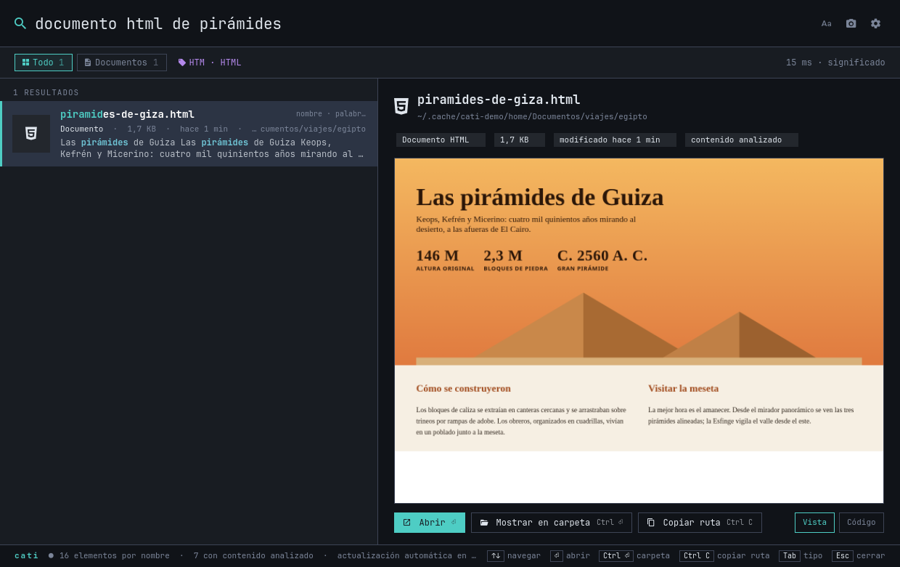

<p align="center">
  
</p>

<h1 align="center">Cati</h1>

<p align="center">
  <b>Encuentra cualquier archivo de tu Linux describiéndolo con tus palabras.</b><br>
  Al instante, en local y con vista previa.
</p>

<p align="center">
  <i>Find any file on Linux by describing it in plain language — instant, private, with live previews.</i>
</p>

---

Escribe «documento html de pirámides», «fotos de ayer», «pdfs en descargas» o «la factura del dentista» y Cati lo encuentra aunque no recuerdes cómo se llama el archivo ni dónde lo guardaste. Busca por **nombre**, por **contenido** (texto, PDF, Office libre y el texto que aparece en fotos y capturas) y por **significado** (lo que se ve en una foto, de qué trata un documento o cómo suena un audio), y lo muestra con una vista previa real a la derecha.

Todo ocurre en tu equipo: no hay nube, cuentas ni telemetría.

<p align="center"></p>

## Lo que la hace distinta

- **Entiende frases, no solo palabras.** «vídeos de más de 1 GB», «presentaciones de marzo», «fotos de la semana pasada en descargas», «carpeta de egipto»: tipo, extensión, fechas, tamaño y ubicación se interpretan como filtros, y el resto es el tema que buscas.
- **Instantánea.** Los resultados por nombre y palabras aparecen mientras escribes (1–10 ms) y los de significado se incorporan en cuanto el modelo responde (20–60 ms con el modelo cargado).
- **Lo encuentra todo desde el primer minuto.** Todos tus archivos y carpetas se pueden buscar por nombre en segundos. El análisis del contenido continúa en segundo plano, se reanuda solo y prioriza lo que acabas de crear o modificar.
- **Vista previa de verdad:**
  - páginas HTML renderizadas;
  - PDF en la página exacta donde aparece lo que buscas;
  - imágenes a tamaño completo;
  - vídeo y audio que se reproducen desde el instante relevante;
  - código y Markdown con sintaxis coloreada y tus palabras resaltadas;
  - carpetas con cuadrícula de fotos.
- **Búsqueda por voz.** Pulsa **Super + Alt + V** (o Alt + V con Cati abierta, o el micrófono), habla y suelta: se detiene sola al callarte y transcribe en tu equipo con [whisper.cpp](https://github.com/ggml-org/whisper.cpp) por GPU en unos 350 ms. Entiende búsquedas («búscame la factura del dentista») y órdenes sobre los resultados: «abre el segundo», «muéstralo en su carpeta», «propiedades», «siguiente», «bórralo», «cierra». En reposo no consume nada.
- **Tolera erratas.** «piramdes», «lactnte febril» o «egpto» encuentran lo que querías, marcado como *nombre aproximado*.
- **Lee dentro de todo.** Texto, Markdown, HTML, PDF (incluidas sus fotos, por página), DOCX, XLSX, PPTX, ODT, ODS, ODP, EPUB, RTF y DOC (con `antiword`). Las imágenes incrustadas en documentos se buscan por lo que muestran.
- **Es también un explorador.** Una barra lateral con tus lugares y discos, migas de pan, atrás/adelante y orden por nombre, fecha, tamaño o tipo. Escribe dentro de una carpeta y la búsqueda se limita a ella (incluso en discos que no se indexan: entonces mira el disco al momento).
- **Filtros y búsquedas guardadas.** Acota por fecha (hoy, 7 días, 30 días, este año) y tamaño (pequeños, grandes, enormes) sin escribir nada. Guarda con ★ una consulta con sus filtros y vuelve a ella en un clic desde la barra lateral: se ejecuta de nuevo cada vez, como una carpeta inteligente.
- **Recientes y más usados.** Cati recuerda, solo en tu equipo, qué abres y cuánto: «Abiertos hace poco» y «Más usados» están a un clic, y lo que abres a menudo sube un poco al ordenar.
- **Acciones sobre varios archivos.** Marca con Ctrl + Espacio, Ctrl + clic o Mayús + clic y aplica a todos: mover, copiar, comprimir en ZIP, enviar a la papelera o renombrar en lote (buscar y reemplazar, numerar, mayúsculas o prefijo/sufijo) con vista previa de cada nombre. Nunca sobrescribe y todo se puede deshacer.
- **Duplicados y espacio.** *Duplicados* encuentra archivos idénticos (mismo contenido, no solo mismo nombre; los enlaces duros no cuentan), muestra cuánto espacio recuperas y marca las copias sobrantes conservando la más antigua. *Espacio en disco* muestra qué carpetas ocupan más, con barras, y entras en ellas para seguir.
- **Gestiona lo que encuentra.** Renombrar (F2), mover a otra carpeta (Ctrl + M), copiar (Ctrl + Mayús + M), comprimir (Ctrl + E) o enviar a la papelera (Ctrl + Supr), siempre con *Deshacer*.
- **Propiedades completas.** Con *Propiedades* (Alt + Enter o clic derecho) ves fechas (incluida la de creación), permisos, propietario, cámara, objetivo y GPS de las fotos, autor y páginas de los PDF, códecs de vídeo y audio, autor de documentos de Office y, con ExifTool instalado, todos los metadatos EXIF, XMP, IPTC, QuickTime o ID3. Un clic en cualquier valor lo copia.
- **Ordena con criterio.** Combina nombre, palabras y significado, agrupa copias y versiones repetidas («+2 copias») y premia el archivo cuyo nombre contiene lo que escribiste.
- **Caché de nombres e índice incremental.** El catálogo persiste entre aperturas. Crear, mover o borrar una carpeta actualiza solo su subárbol; una revisión periódica recupera eventos perdidos. Las búsquedas reservan candidatos para nombres de carpetas y coincidencias completas, y comparten una caché de hasta 16 consultas y 6.000 candidatos entre las pasadas rápida y semántica. Los cambios del índice invalidan esa caché automáticamente.
- **Ligera y rápida analizando.**
  - Las copias exactas (backups, descargas repetidas) se analizan una sola vez; en un equipo real eran un 34 % de los archivos.
  - Los embeddings usan la GPU por Vulkan (AMD, NVIDIA o Intel) y, si no hay, la CPU. En equipos NVIDIA el OCR también va por GPU.
  - El análisis solo aprovecha CPU que nadie más usa, con disco en modo inactivo y tope de memoria, y en portátiles con batería baja a un solo trabajo.
  - La interfaz queda residente con unos 130 MB. El modelo y el OCR liberan su memoria cuando no se usan.

## Instalación

```bash
git clone https://github.com/charlieRub/cati.git
cd cati
./install.sh --deps      # --deps instala con sudo los paquetes del sistema que falten
```

El instalador:

1. Comprueba dependencias y te dice el comando exacto para tu distribución.
2. Crea un entorno de Python.
3. Descarga y verifica el modelo (≈865 MB, una sola vez).
4. Compila el motor local, con GPU por Vulkan si está disponible y si no en CPU.
5. Configura el arranque en segundo plano y un atajo de teclado.

No necesita root salvo para `--deps`.

| Distribución | Probado | Notas |
| --- | --- | --- |
| Arch, CachyOS, EndeavourOS, Manjaro | ✓ | Paquetes por `pacman` |
| Omarchy | ✓ | Integración nativa (ver abajo) |
| Debian 13, Ubuntu 24.04+, Mint 22+ | — | Paquetes por `apt`; requiere GTK ≥ 4.12 |
| Fedora 40+ | — | Paquetes por `dnf` |
| openSUSE Tumbleweed | — | Paquetes por `zypper` |

Funciona en Wayland y X11, con o sin systemd. `cati doctor` diagnostica en cualquier momento lo que falta.

Opciones: `--gpu auto|vulkan|cpu`, `--shortcut "SUPER ALT, E"` (Hyprland) o `"<Super><Alt>e"` (GNOME), `--no-shortcut`, `--uninstall [--purge]`.

### Omarchy y Hyprland

Cati usa los colores del tema activo de Omarchy y los relee cada vez que se abre, de modo que cambiar de tema se nota al momento. Aparece en Walker y tiene dos accesos: **Super + Alt + E** abre el **E**xplorador de archivos a pantalla completa, con barra lateral, y **Super + Alt + B** la **B**úsqueda rápida, en ventana flotante centrada. **Super + Alt + V** busca por voz. Dentro de Cati, **F11** (o el botón junto a los ajustes) pasa de un modo a otro. En Hyprland, el instalador escribe `~/.config/hypr/cati.conf` (reglas de ventana, atajo y arranque residente) y lo incluye desde `hyprland.conf` con copia de seguridad. Si Hyprland rechaza la configuración, la revierte.

En GNOME configura los atajos automáticamente. En KDE los propone en la entrada de la aplicación. En el resto de escritorios basta con asignar atajos a `cati explorer` (explorador) y `cati quick` (búsqueda rápida).

## Uso

| Tecla | Acción |
| --- | --- |
| Escribir | Buscar (no hace falta pulsar Enter) |
| ↑ ↓, RePág, AvPág | Moverse por los resultados |
| Enter | Abrir (PDF en su página, vídeo en su instante); en una carpeta, entrar en ella |
| Ctrl + Enter | Mostrar en el gestor de archivos |
| Alt + ←, Alt + →, Alt + ↑, Retroceso | Atrás, adelante y carpeta superior (con la caja vacía) |
| Ctrl + B | Mostrar u ocultar la barra lateral |
| Ctrl + S | Guardar la búsqueda y sus filtros |
| Ctrl + Espacio, Insertar, Mayús + ↑ ↓ | Marcar (y avanzar); Ctrl + A marca todo con la caja vacía |
| Ctrl + C | Copiar el archivo y su ruta (todos los marcados, si los hay) |
| Tab, Shift + Tab | Cambiar de tipo (Todo, Carpetas, Documentos, Imágenes…) |
| Alt + Enter, clic derecho | Propiedades y metadatos |
| Alt + V | Buscar por voz (Super + Alt + V desde cualquier sitio) |
| F2, Ctrl + M, Ctrl + Mayús + M, Ctrl + E, Ctrl + Supr | Renombrar, mover, copiar, comprimir, papelera (sobre lo marcado o el resultado actual) |
| Ctrl + Z | Deshacer la última acción de archivo |
| Alt + ← → | Página anterior o siguiente en PDF |
| Esc | Quitar la selección y, si no hay, cerrar (Cati sigue residente) |
| F11 | Pasar del explorador a pantalla completa a la búsqueda rápida, y al revés |

También puedes **arrastrar** un resultado a otra aplicación, o **soltar una foto** en la ventana para buscar imágenes parecidas.

### Ejemplos

| Escribes | Cati entiende |
| --- | --- |
| `documento html de pirámides` | Archivos `.html`/`.htm` sobre pirámides |
| `foto de una pirámide` | Imágenes que *muestran* una pirámide, se llamen como se llamen |
| `pdfs en descargas de la semana pasada` | PDF en `~/Descargas` modificados la semana anterior |
| `carpeta de egipto` | Carpetas con ese nombre y carpetas llenas de archivos sobre Egipto |
| `excel de gastos del año pasado` | `.xlsx`, `.xls`, `.ods` y `.csv` sobre gastos, del año anterior |
| `vídeos de más de 1 GB` | Vídeos grandes, los más recientes primero |
| `facturas de 2024` | Prioriza 2024 sin descartar archivos con «2024» en el nombre |
| `contrato que permite tener perro` | Contenido por significado, aunque diga «mascotas» |
| `code: retry_request` | Código fuente (si activas su análisis) |

### Línea de órdenes

```bash
cati                          # abre la ventana
cati search "fotos de ayer"   # resultados en JSON
cati status                   # estado del índice
cati doctor                   # dependencias
cati voice                    # abre Cati escuchando (para tu propio atajo)
cati voice --file nota.wav    # transcribe e interpreta un audio
```

## Cómo funciona

```
          inotify + revisión periódica
                     │
  tus archivos ──► catálogo de nombres (SQLite FTS5 trigram) ──┐
                     │                                         │
                     └─► lectores (texto, PDF, OCR, FFmpeg) ──► embeddings locales ──► índice
                                                                     │
  tu frase ──► intérprete (tipo, extensión, fechas, lugar, tema) ───┤
                                                                     ▼
                                       fusión: nombre + palabras + significado ──► resultados
```

- **Catálogo**: todos los archivos y carpetas visibles, actualizados por inotify en menos de un segundo.
- **OCR**: [PP-OCRv6](https://github.com/PaddlePaddle/PaddleOCR) por ONNX (RapidOCR) lee el texto de fotos, capturas y PDF escaneados, y solo reconoce zonas donde detecta texto. Tesseract queda de respaldo.
- **Contenido**: el texto se trocea y se indexa por palabras (FTS5) y por significado. Las imágenes, fotogramas de vídeo y fragmentos de audio se codifican con el mismo modelo multimodal, así que una frase en español encuentra una foto.
- **Motor**: [llama.cpp](https://github.com/ggml-org/llama.cpp) con EmbeddingGemma 2, escuchando solo en `127.0.0.1` y con clave. Tiene dos ranuras, para que una búsqueda no espere detrás del análisis.
- **Búsqueda**: en memoria solo hay una huella binaria de cada fragmento (96 bytes; unos 14 MB para 150.000). La distancia Hamming ordena todo el índice en milisegundos y los vectores completos, guardados en disco, se leen solo para el 7 % de mejores candidatos (recall ≥ 98 % frente a la búsqueda exacta). Al arrancar se carga una copia en disco, de modo que lo ya analizado nunca se recalcula ni se relee. Mientras escribes, el análisis de fondo cede la GPU.
- **Voz**: graba hasta detectar silencio, recorta el contexto de audio de Whisper a la duración real de la frase (unas cinco veces menos trabajo) y mantiene el modelo cargado solo mientras usas la voz.

## Privacidad

Nada sale de tu equipo; la única conexión de red es la descarga inicial del modelo y del motor. Los originales nunca se modifican. Quedan excluidos:

- carpetas ocultas y dependencias (`node_modules`, `venv`…);
- claves, certificados y archivos con nombres como *password*, *secret* o *credential*.

Las páginas HTML se renderizan para la vista previa con Chromium sin perfil y **sin acceso a internet**.

## Configuración

`~/.config/cati/config.json` (también desde ⚙ en la ventana):

| Clave | Por defecto | Qué hace |
| --- | --- | --- |
| `scope` | `"computer"` | `computer`: carpeta personal y discos montados; `folders`: solo `folders` |
| `folders` | Documentos, Descargas | Carpetas cuando `scope` es `folders` |
| `media` | `true` | Analizar imágenes, audio y vídeo |
| `code` | `false` | Analizar código fuente (búsquedas con `code:`) |
| `theme` | `"auto"` | `auto`: tema de Omarchy si existe; `cati`: paleta propia |
| `workers` | `1` | Trabajos de análisis simultáneos; un trabajador evita picos de memoria |
| `scan_seconds` | `1800` | Revisión completa de respaldo; inotify procesa novedades entre revisiones |
| `scan_debounce_seconds` | `30` | Pausa mínima entre revisiones durante ráfagas de nuevas carpetas |
| `job_delay` | `0.25` | Descanso entre lotes de análisis en segundo plano |
| `background_duty` | `0.25` | Ritmo del motor durante la indexación: descansa entre solicitudes; las búsquedas no esperan |
| `engine_idle` | `900` | Segundos sin uso antes de liberar el modelo |
| `exclude` | — | Rutas que nunca se recorren |

Datos en `~/.local/share/cati/`: índice, miniaturas y modelos.

El texto extraído se reutiliza entre lotes y reinicios. La caché ocupa como máximo 16 MiB en RAM
y 128 MiB en `~/.cache/cati/text-v1/`; cambia automáticamente cuando cambia el archivo.
La vigilancia usa prioridad e I/O bajos y un máximo de 35 % de **un hilo** de CPU, no del equipo
completo. Las descargas de dependencias de Go (`$GOPATH/pkg`) se excluyen del análisis.

## Desinstalar

```bash
./install.sh --uninstall          # conserva índice y modelos
./install.sh --uninstall --purge  # lo borra todo
```

## Desarrollo

```bash
python -m unittest tests.test_query              # sin modelo (lo que corre en CI)
PYTHONPATH=.:tests .venv/bin/python -m unittest test_integration test_quality   # con el modelo real
.venv/bin/python -m unittest tests.test_files    # explorador, lotes, duplicados y espacio (sin modelo)
.venv/bin/python tests/gui_explorer.py           # prueba la ventana de verdad (necesita sesión gráfica)
```

## Licencia

[MIT](LICENSE). Los componentes de terceros y sus licencias están en [THIRD_PARTY_NOTICES.md](THIRD_PARTY_NOTICES.md).

### Arranque y cachés de búsqueda

El explorador y las búsquedas de texto cargan únicamente los metadatos necesarios;
los vectores se abren al solicitar búsqueda semántica. Abrir una ventana no despierta
el modelo. La primera consulta semántica puede tardar más si el motor estaba dormido.
Los vectores se leen y compactan por lotes; las imágenes de consulta invalidan su
caché cuando cambia el archivo. Los identificadores de fragmentos son monotónicos
para que una modificación nunca herede el vector de un fragmento borrado.

Al ocultar/cerrar la ventana, Cati conserva la navegación y descarga tras 60 segundos
los vectores de búsqueda y las cachés de miniaturas/vistas previas. Reabrir antes
cancela esa descarga; después, los vectores se recuperan desde disco cuando se
necesitan. El vigilante de archivos funciona independientemente de la ventana.
